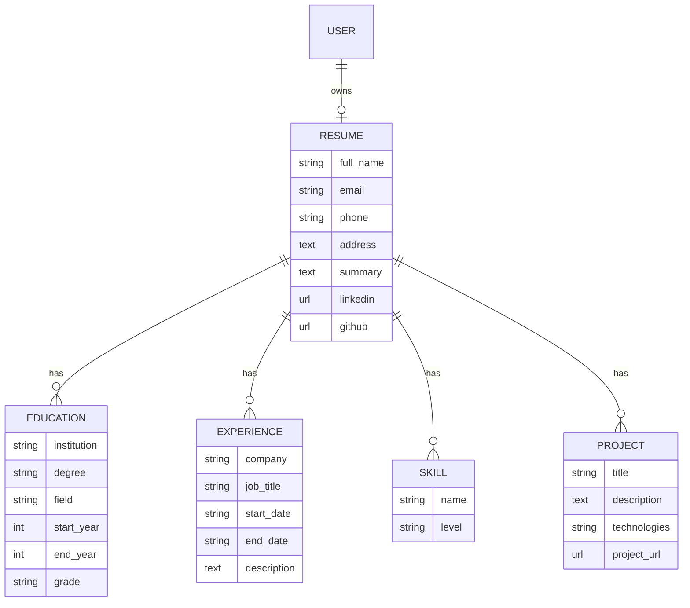
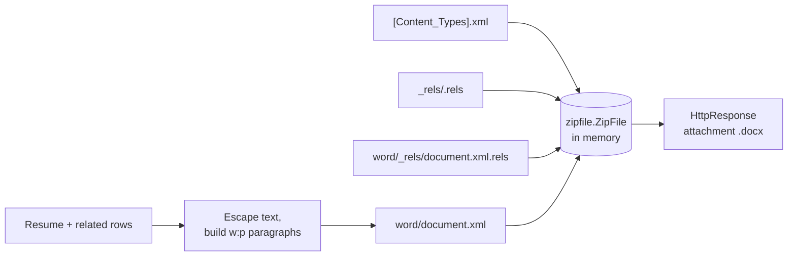

<div align="center">



<br/>

[](https://www.python.org/)
[](https://www.djangoproject.com/)
[](https://www.sqlite.org/)
[](#how-it-works)
[](https://sanal37.pythonanywhere.com/)

**[▶ How it works](#how-it-works)** &nbsp;·&nbsp; **[✦ Features](#features)** &nbsp;·&nbsp; **[⚙ Under the hood](#under-the-hood)** &nbsp;·&nbsp; **[⚡ Quick start](#quick-start)** &nbsp;·&nbsp; **[🗂 Structure](#project-structure)**

</div>


## What is ResumeCraft?

**ResumeCraft** walks you through building a resume one small step at a time, shows it taking shape on a live A4 preview, and then hands it back as an **editable Word document** or a **print-ready PDF**.

No templates to fight, no formatting to fix. Fill in the blanks, watch the page build itself, download.

<br/>

<a id="how-it-works"></a>

## ▶ How it works

Everything below is real behaviour from the app, animated. Three core checks (contact info, education, skills) drive the completion meter from 33% to 66% to 100%, and the export produces a genuine `.docx`.

<div align="center">

</div>

<br/>

### The wizard

Every "Save &amp; Continue" button moves you to the next stop. Experience and Projects are optional; they never block your completion score.

<div align="center">

</div>


<a id="features"></a>

## ✦ Features

<div align="center">

</div>


<a id="under-the-hood"></a>

## ⚙ Under the hood

A request enters through `urls.py`, passes the `@login_required` gate in `views.py`, and ends up in one of three places: the database, the print-ready preview, or the DOCX generator.

<div align="center">

</div>

<br/>

### Data model

One user owns one resume. Each section is a child table hanging off it.



<details>
<summary><b>📄 How the .docx is made (no python-docx involved)</b></summary>

<br/>

The export view assembles a valid Word file by hand: it builds the Open XML for each paragraph, then packs the four required parts into a ZIP held in memory. The response is sent straight back as a download named like `Alex_Morgan_Resume.docx`.



The **PDF** path is the browser's own: `/preview/` renders a true A4 page with a print stylesheet, and the **Print / Save PDF** button calls `window.print()`.

</details>

<details>
<summary><b>🧮 How the completion meter works</b></summary>

<br/>

`get_completion()` runs three boolean checks and reports the share that pass:

| Check | Passes when |
|---|---|
| Contact info | `full_name`, `email` and `phone` are all filled |
| Education | at least one education entry exists |
| Skills | at least one skill exists |

Three checks gives you **33% → 66% → 100%**. Experience and Projects are intentionally optional and don't count toward it.

</details>

<details>
<summary><b>🧭 Route map (21 routes)</b></summary>

<br/>

| Area | Route | Purpose |
|---|---|---|
| Public | `/` | Landing page |
| Auth | `/register/` · `/login/` · `/logout/` | Account lifecycle |
| Workspace | `/dashboard/` | Progress overview and section cards |
| Personal | `/resume/` | Create or edit contact details and summary |
| Education | `/education/` · `edit/<pk>/` · `delete/<pk>/` | Add, edit, remove |
| Experience | `/experience/` · `edit/<pk>/` · `delete/<pk>/` | Add, edit, remove |
| Skills | `/skill/` · `edit/<pk>/` · `delete/<pk>/` | Add, edit, remove |
| Projects | `/project/` · `edit/<pk>/` · `delete/<pk>/` | Add, edit, remove |
| Finish | `/review/` · `/preview/` · `/download/docx/` | Check, preview A4, export |
| Admin | `/admin/` | All five models registered |

Every `edit` and `delete` route looks the object up with `resume__user=request.user`, so one account can never touch another's data.

</details>


<a id="quick-start"></a>

## ⚡ Quick start

<div align="center">

</div>

<br/>

The animation isn't copy-pasteable, so here are the same steps:

```bash
git clone https://github.com/midhun-creator/resume-builder.git
cd resume-builder

python -m venv .venv
source .venv/bin/activate          # Windows: .venv\Scripts\activate

pip install -r requirements.txt
python manage.py migrate
python manage.py runserver
```

Open **http://127.0.0.1:8000/**, create an account, and start building.

Want the admin panel? Run `python manage.py createsuperuser` and visit `/admin/`.

> Built on **Python 3.12**.


## 🧱 Tech stack

| Layer | Choice | Notes |
|---|---|---|
| Backend | **Django** | Auth, ORM, forms, templates, admin |
| Database | **SQLite** | Zero-config, file-based |
| Frontend | Server-rendered templates | A hand-written black-and-purple design system in `style.css` |
| Interactivity | **Vanilla JS** (`app.js`) | Scroll reveal, mobile drawer, password toggle. No libraries. |
| Typography | Inter | Loaded from Google Fonts |
| Export | Open XML + `zipfile` | DOCX generated from the standard library |

<a id="project-structure"></a>

<details>
<summary><b>🗂 Project structure</b></summary>

<br/>

```text
resume-builder/
├── manage.py
├── requirements.txt
│
├── resume_builder/                # project configuration
│   ├── settings.py
│   ├── urls.py
│   ├── asgi.py
│   └── wsgi.py
│
└── resume/                        # the app
    ├── models.py                  # Resume · Education · Experience · Skill · Project
    ├── forms.py                   # ModelForms with styled widgets
    ├── views.py                   # wizard, CRUD, review, preview, DOCX export
    ├── urls.py
    ├── admin.py
    ├── migrations/
    ├── static/resume/
    │   ├── style.css              # design system (black / purple)
    │   └── app.js                 # dependency-free JavaScript
    └── templates/resume/
        ├── base.html
        ├── home.html
        ├── login.html · register.html
        ├── dashboard.html · dashboard_base.html
        ├── resume_form.html
        ├── education_form.html    · edit_education.html
        ├── experience_form.html   · edit_experience.html
        ├── skill_form.html        · edit_skill.html
        ├── project_form.html      · edit_project.html
        └── review.html · preview.html
```

</details>

<details>
<summary><b>🚀 Before you deploy</b></summary>

<br/>

The bundled `settings.py` is a development configuration. For a public deployment:

- [ ] Set `DEBUG = False`
- [ ] Load `SECRET_KEY` from an environment variable instead of the source file
- [ ] Keep `ALLOWED_HOSTS` limited to your real domain
- [ ] Run `python manage.py collectstatic` (`STATIC_ROOT` is already set)
- [ ] Keep `db.sqlite3` out of version control (it's in `.gitignore`)

</details>

<br/>


